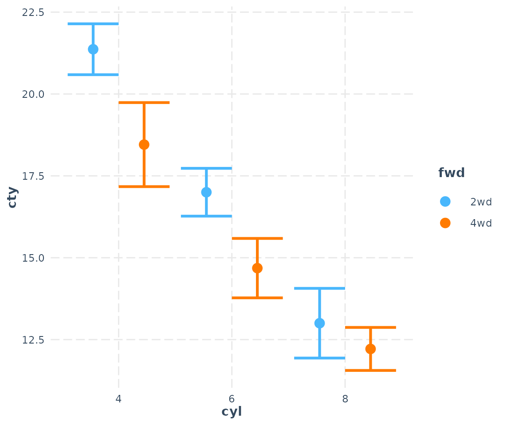
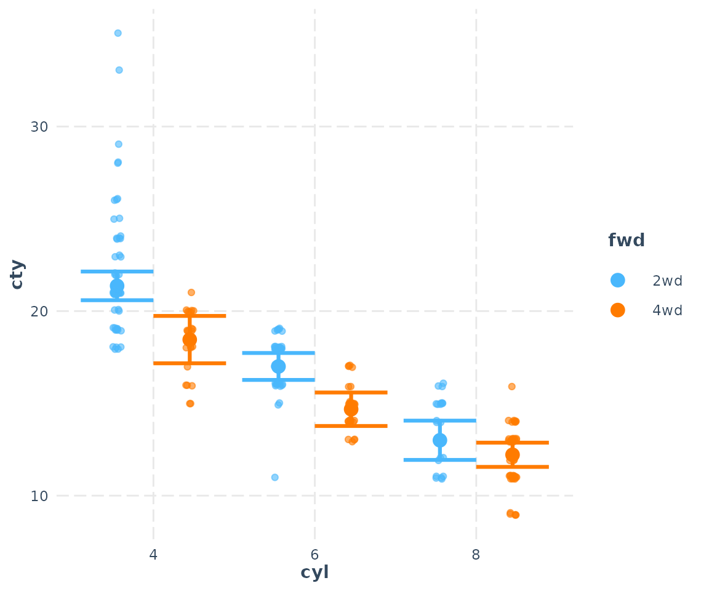
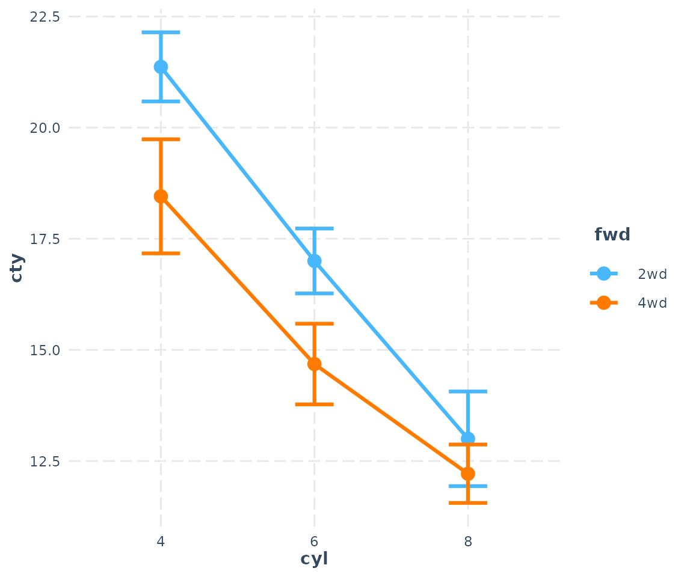
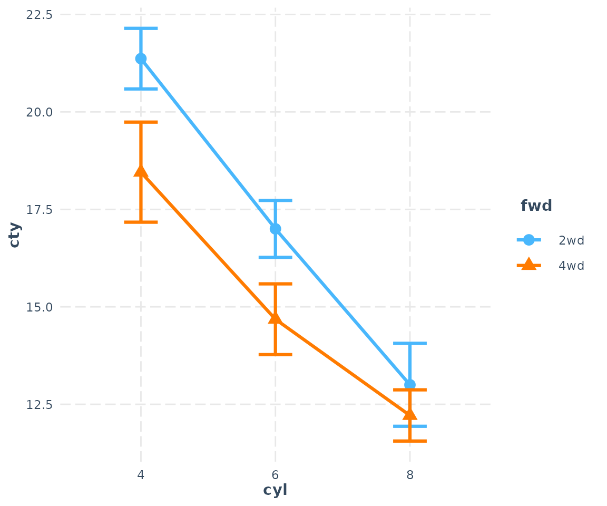
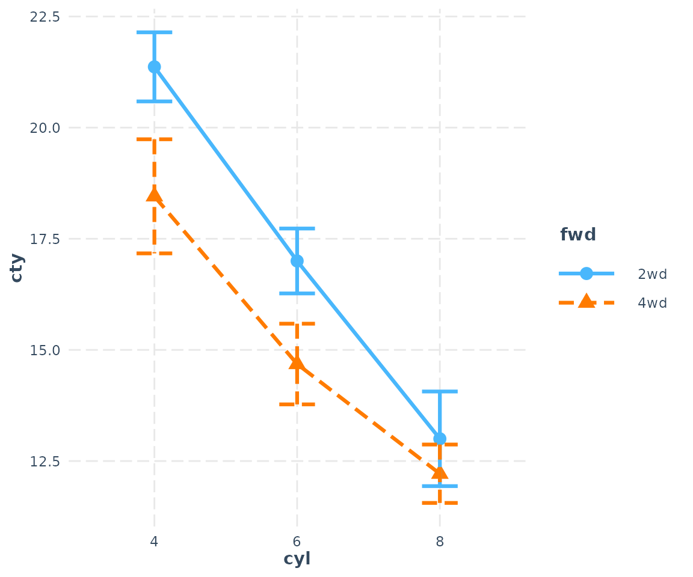
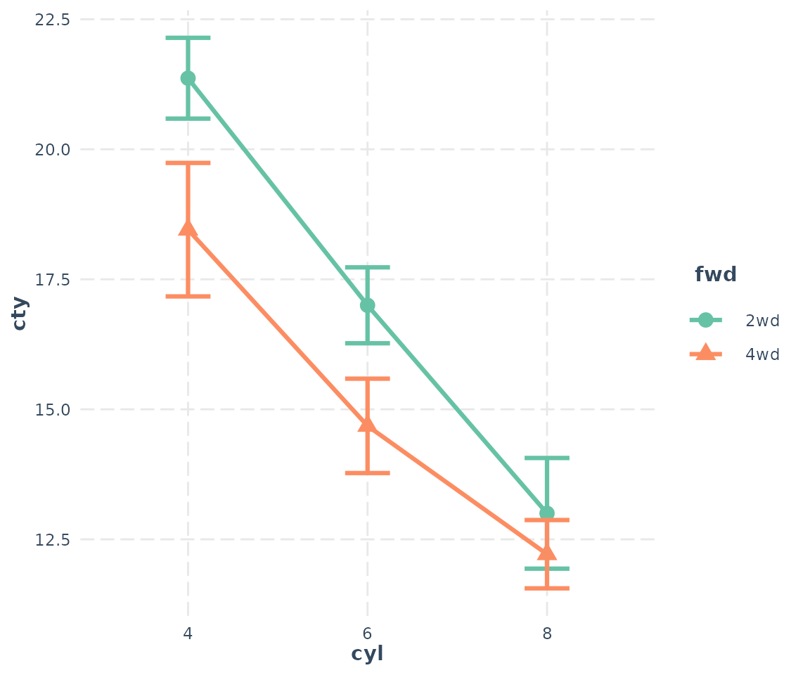
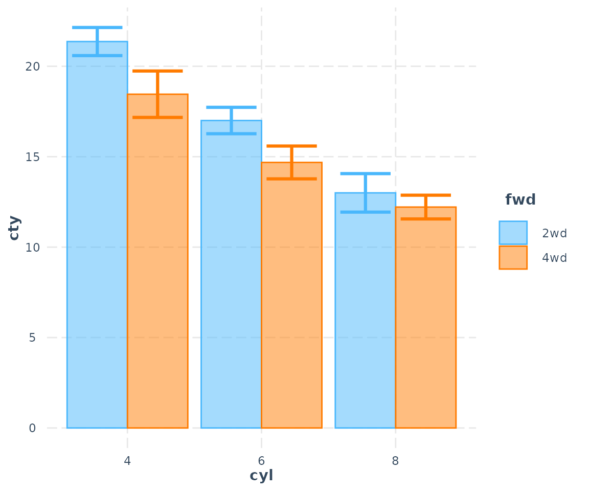
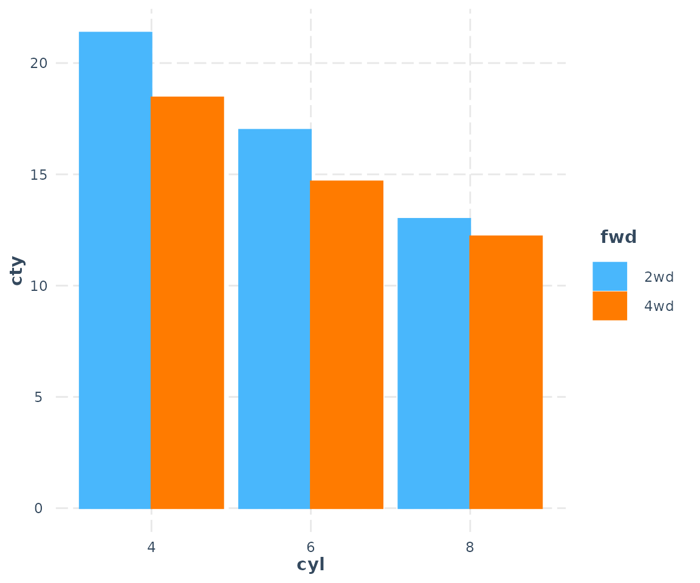
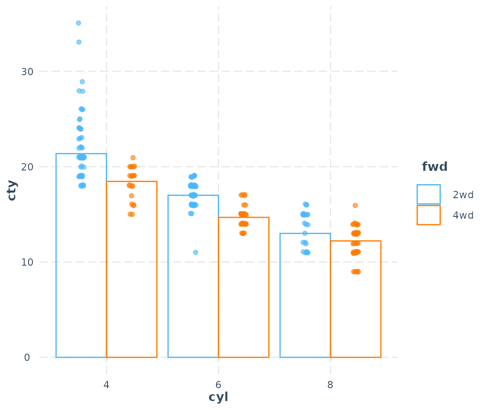

# Plotting interactions among categorical variables in regression models

    ## 
    ## Attaching package: 'interactions'

    ## The following objects are masked from 'package:jtools':
    ## 
    ##     cat_plot, interact_plot, johnson_neyman, probe_interaction,
    ##     sim_slopes

When trying to understand interactions between categorical predictors,
the types of visualizations called for tend to differ from those for
continuous predictors. For that (and some other) reasons, `interactions`
offers support for these in `cat_plot` while continuous predictors
(perhaps in interactions with categorical predictors) are dealt with in
`interact_plot`, which has a separate vignette.

To be clear…

If all the predictors involved in the interaction are categorical, use
`cat_plot`. You can also use `cat_plot` to explore the effect of a
single categorical predictor.

If one or more are continuous, use `interact_plot`.

## Simple two-way interaction

First, let’s prep some data. I’m going to make some slight changes to
the `mpg` dataset from `ggplot2` for didactic purposes to drop a few
factor levels that have almost no values (e.g., there are 5 cylinder
engines?).

``` r

library(ggplot2)
mpg2 <- mpg
mpg2$cyl <- factor(mpg2$cyl)
mpg2["auto"] <- "auto"
mpg2$auto[mpg2$trans %in% c("manual(m5)", "manual(m6)")] <- "manual"
mpg2$auto <- factor(mpg2$auto)
mpg2["fwd"] <- "2wd"
mpg2$fwd[mpg2$drv == "4"] <- "4wd"
mpg2$fwd <- factor(mpg2$fwd)
## Drop the two cars with 5 cylinders (rest are 4, 6, or 8)
mpg2 <- mpg2[mpg2$cyl != "5",]
## Fit the model
fit3 <- lm(cty ~ cyl * fwd * auto, data = mpg2)
```

So basically what we’re looking at here is an interaction between number
of cylinders in the engine of some cars and whether the car has
all-wheel drive or two-wheel drive. The DV is fuel mileage in the city.

Here’s summary output for our model:

``` r

library(jtools) # for summ()
summ(fit3)
```

    ## MODEL INFO:
    ## Observations: 230
    ## Dependent Variable: cty
    ## Type: OLS linear regression 
    ## 
    ## MODEL FIT:
    ## F(11,218) = 61.37, p = 0.00
    ## R² = 0.76
    ## Adj. R² = 0.74 
    ## 
    ## Standard errors:OLS
    ## -----------------------------------------------------------
    ##                                 Est.   S.E.   t val.      p
    ## ---------------------------- ------- ------ -------- ------
    ## (Intercept)                    21.37   0.39    54.19   0.00
    ## cyl6                           -4.37   0.54    -8.07   0.00
    ## cyl8                           -8.37   0.67   -12.51   0.00
    ## fwd4wd                         -2.91   0.76    -3.83   0.00
    ## automanual                      1.45   0.57     2.56   0.01
    ## cyl6:fwd4wd                     0.59   0.96     0.62   0.54
    ## cyl8:fwd4wd                     2.13   0.99     2.15   0.03
    ## cyl6:automanual                -0.76   0.90    -0.84   0.40
    ## cyl8:automanual                 0.71   1.18     0.60   0.55
    ## fwd4wd:automanual              -1.66   1.07    -1.56   0.12
    ## cyl6:fwd4wd:automanual          1.29   1.52     0.85   0.40
    ## cyl8:fwd4wd:automanual         -1.39   1.76    -0.79   0.43
    ## -----------------------------------------------------------

Let’s see what happens using all the default arguments:

``` r

cat_plot(fit3, pred = cyl, modx = fwd)
```



This is with `geom = "point"`. We can see a main effect of `cyl` and
maybe something is going on with the interaction as well, since the
different between `2wd` and `4wd` seems to decrease as `cyl` gets
higher.

You can also plot the observed data on the plot:

``` r

cat_plot(fit3, pred = cyl, modx = fwd, plot.points = TRUE)
```



## Line plots

And since `cyl` does have a clear order, it might make more sense to
connect those dots. Let’s try `geom = "line"`:

``` r

cat_plot(fit3, pred = cyl, modx = fwd, geom = "line")
```



Okay, that makes the trend quite a bit clearer.

You have some other options, too. Suppose you will need this plot to
look good in black and white. Let’s change the shape of those points for
different values of the moderator.

``` r

cat_plot(fit3, pred = cyl, modx = fwd, geom = "line", point.shape = TRUE)
```



You can change the line patterns as well for more clarity.

``` r

cat_plot(fit3, pred = cyl, modx = fwd, geom = "line", point.shape = TRUE,
         vary.lty = TRUE)
```



You may also choose any color palette from `RColorBrewer` as well as
several preset palettes available in `jtools`:

``` r

cat_plot(fit3, pred = cyl, modx = fwd, geom = "line", point.shape = TRUE,
         colors = "Set2")
```



Use
[`?jtools_colors`](https://jtools.jacob-long.com/reference/jtools_colors.html)
for more on your color options.

## Bar/dynamite plots

Last but not least, you can also make bar charts, AKA dynamite plots.
For many situations, these are not the best way to show your data, but I
know it’s what a lot of people are looking for.

``` r

cat_plot(fit3, pred = cyl, modx = fwd, geom = "bar")
```



The transparency of the fill color depends on the presence of the error
bars and observed data points.

``` r

cat_plot(fit3, pred = cyl, modx = fwd, geom = "bar", interval = FALSE)
```



Now let’s look with observed data:

``` r

cat_plot(fit3, pred = cyl, modx = fwd, geom = "bar", interval = FALSE,
         plot.points = TRUE)
```


