# Exploring interactions with continuous predictors in regression models

    ## 
    ## Attaching package: 'interactions'

    ## The following objects are masked from 'package:jtools':
    ## 
    ##     cat_plot, interact_plot, johnson_neyman, probe_interaction,
    ##     sim_slopes

Understanding an interaction effect in a linear regression model is
usually difficult when using just the basic output tables and looking at
the coefficients. The `interactions` package provides several functions
that can help analysts probe more deeply.

**Categorical by categorical interactions**: All the tools described
here require at least one variable to be continuous. A separate vignette
describes `cat_plot`, which handles the plotting of interactions in
which all the focal predictors are categorical variables.

First, we use example data from `state.x77` that is built into R. Let’s
look at the interaction model output with `summ` as a starting point.

``` r

library(jtools) # for summ()
states <- as.data.frame(state.x77)
fiti <- lm(Income ~ Illiteracy * Murder + `HS Grad`, data = states)
summ(fiti)
```

    ## MODEL INFO:
    ## Observations: 50
    ## Dependent Variable: Income
    ## Type: OLS linear regression 
    ## 
    ## MODEL FIT:
    ## F(4,45) = 10.65, p = 0.00
    ## R² = 0.49
    ## Adj. R² = 0.44 
    ## 
    ## Standard errors:OLS
    ## ----------------------------------------------------------
    ##                              Est.     S.E.   t val.      p
    ## ----------------------- --------- -------- -------- ------
    ## (Intercept)               1414.46   737.84     1.92   0.06
    ## Illiteracy                 753.07   385.90     1.95   0.06
    ## Murder                     130.60    44.67     2.92   0.01
    ## HS Grad                     40.76    10.92     3.73   0.00
    ## Illiteracy:Murder          -97.04    35.86    -2.71   0.01
    ## ----------------------------------------------------------

Our interaction term is significant, suggesting some more probing is
warranted to see what’s going on. It’s worth recalling that you
shouldn’t focus too much on the main effects of terms included in the
interaction since they are conditional on the other variable(s) in the
interaction being held constant at 0.

## Plotting interactions

A versatile and sometimes the most interpretable method for
understanding interaction effects is via plotting. `interactions`
provides `interact_plot` as a relatively pain-free method to get
good-looking plots of interactions using `ggplot2` on the backend.

``` r

interact_plot(fiti, pred = Illiteracy, modx = Murder)
```

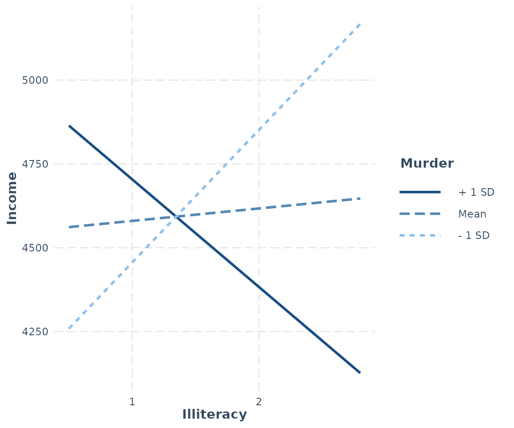

Keep in mind that the default behavior of `interact_plot` is to
mean-center all continuous variables not involved in the interaction so
that the predicted values are more easily interpreted. You can disable
that by adding `centered = "none"`. You can choose specific variables by
providing their names in a vector to the `centered` argument.

By default, with a continuous moderator you get three lines — 1 standard
deviation above and below the mean and the mean itself. If you specify
`modx.values = "plus-minus"`, the mean of the moderator is not plotted,
just the two +/- SD lines. You may also choose `"terciles"` to split the
data into three equal-sized groups — representing the upper, middle, and
lower thirds of the distribution of the moderator — and get the line
that represents the median of the moderator within each of those groups.

If your moderator is **a factor**, each level will be plotted and you
should leave `modx.values = NULL`, the default.

``` r

fitiris <- lm(Petal.Length ~ Petal.Width * Species, data = iris)
interact_plot(fitiris, pred = Petal.Width, modx = Species)
```

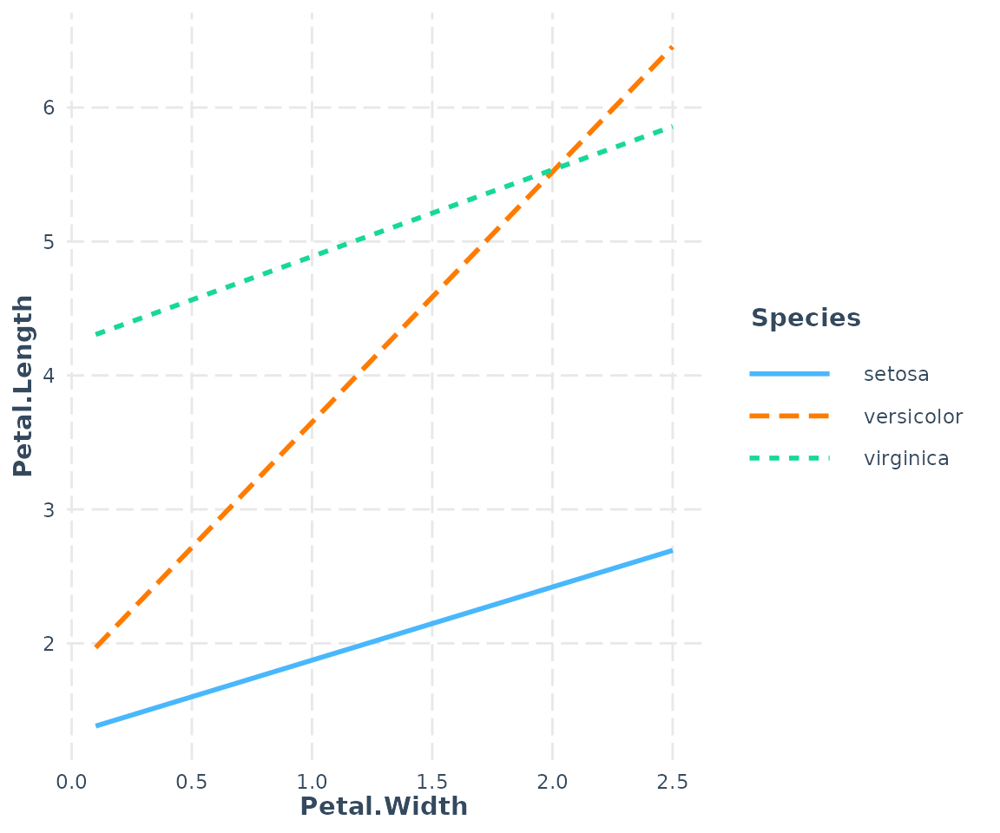

If you want, you can specify a subset of a factor’s levels via the
`modx.values` argument:

``` r

interact_plot(fitiris, pred = Petal.Width, modx = Species,
              modx.values = c("versicolor", "virginica"))
```

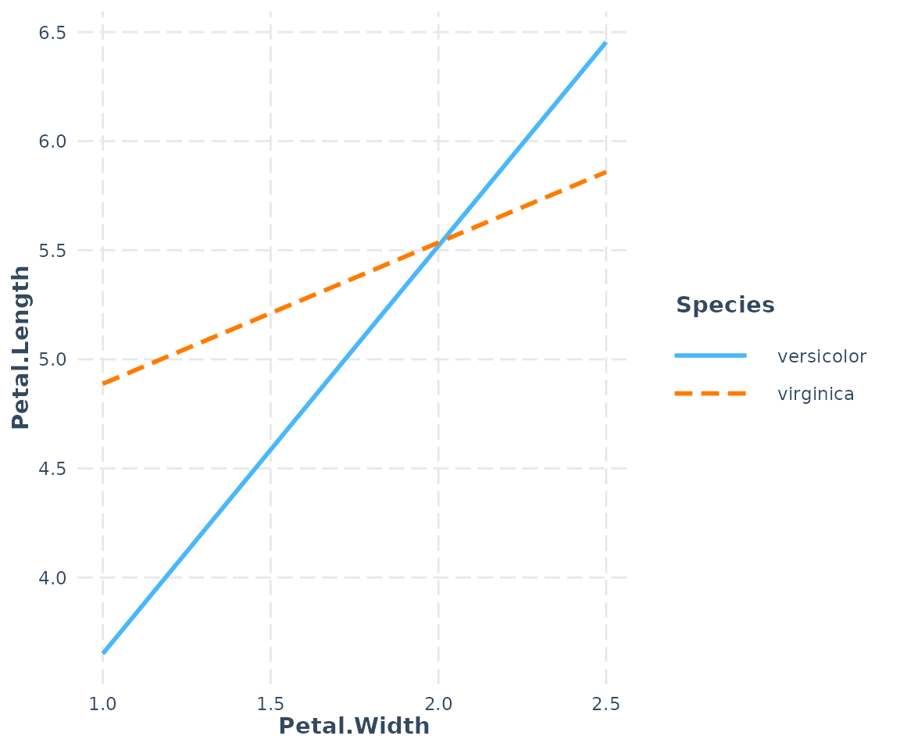

### Plotting observed data

If you want to see the individual data points plotted to better
understand how the fitted lines related to the observed data, you can
use the `plot.points = TRUE` argument.

``` r

interact_plot(fiti, pred = Illiteracy, modx = Murder, plot.points = TRUE)
```

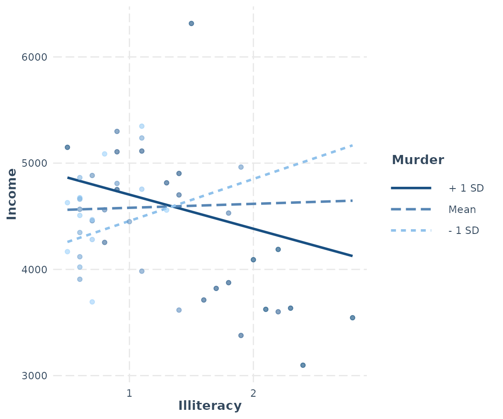

For continuous moderators, as you can see, the observed data points are
shaded depending on the level of the moderator variable.

It can be very enlightening, too, for categorical moderators.

``` r

interact_plot(fitiris, pred = Petal.Width, modx = Species,
              plot.points = TRUE)
```

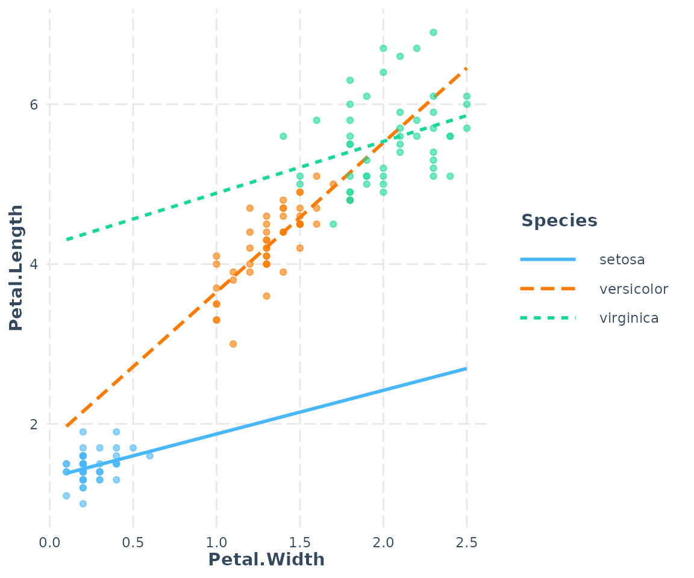

Where many points are slightly overlapping as they do here, it can be
useful to apply a random “jitter” to move them slightly to stop the
overlap. Use the `jitter` argument to do this. If you provide a single
number it will apply a jitter of proportional magnitude both sideways
and up and down. If you provide a vector length 2, then the first is
assumed to refer to the left/right jitter and the second to the up/down
jitter.

If you would like to better differentiate the points with factor
moderators, you can use `point.shape = TRUE` to give a different shape
to each point. This can be especially helpful for black and white
publications.

``` r

interact_plot(fitiris, pred = Petal.Width, modx = Species,
              plot.points = TRUE, jitter = 0.1, point.shape = TRUE)
```

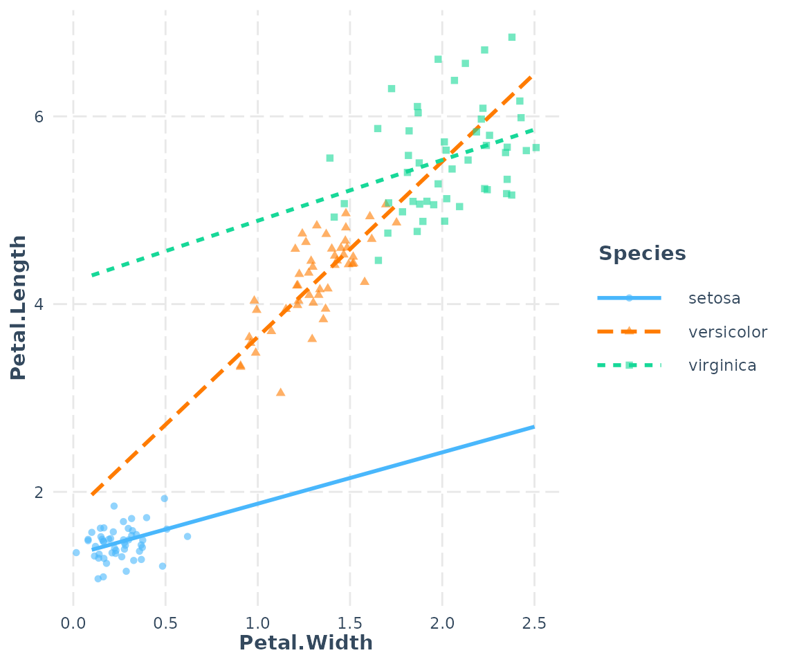

If your original data are weighted, then the points will be sized based
on the weight. For the purposes of our example, we’ll weight the same
model we’ve been using with the population of each state.

``` r

fiti <- lm(Income ~ Illiteracy * Murder, data = states,
           weights = Population)
interact_plot(fiti, pred = Illiteracy, modx = Murder, plot.points = TRUE)
```

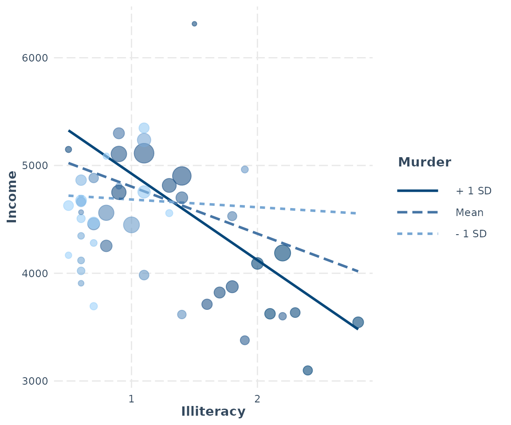

For those working with weighted data, it can be hard to use a
scatterplot to explore the data unless there is some way to account for
the weights. Using size is a nice middle ground.

### Plotting partial residuals

In more complex regressions, plotting the observed data can sometimes be
relatively uninformative because the points seem to be all over the
place.

For an example, let’s take a look at this model. I am using the `mpg`
dataset from `ggplot2` and predicting the city miles per gallon (`cty`)
based on several variables, including model year, type of car, fuel
type, drive type, and an interaction between engine displacement
(`displ`) and number of cylinders in the engine (`cyl`). Let’s take a
look at the regression output:

``` r

library(ggplot2)
data(cars)
fitc <- lm(cty ~ year + cyl * displ + class + fl + drv, data = mpg)
summ(fitc)
```

    ## MODEL INFO:
    ## Observations: 234
    ## Dependent Variable: cty
    ## Type: OLS linear regression 
    ## 
    ## MODEL FIT:
    ## F(16,217) = 99.73, p = 0.00
    ## R² = 0.88
    ## Adj. R² = 0.87 
    ## 
    ## Standard errors:OLS
    ## -------------------------------------------------------
    ##                            Est.    S.E.   t val.      p
    ## --------------------- --------- ------- -------- ------
    ## (Intercept)             -200.98   47.01    -4.28   0.00
    ## year                       0.12    0.02     5.03   0.00
    ## cyl                       -1.86    0.28    -6.69   0.00
    ## displ                     -3.56    0.66    -5.41   0.00
    ## classcompact              -2.60    0.93    -2.80   0.01
    ## classmidsize              -2.63    0.93    -2.82   0.01
    ## classminivan              -4.41    1.04    -4.24   0.00
    ## classpickup               -4.37    0.93    -4.68   0.00
    ## classsubcompact           -2.38    0.93    -2.56   0.01
    ## classsuv                  -4.27    0.87    -4.92   0.00
    ## fld                        6.34    1.69     3.74   0.00
    ## fle                       -4.57    1.66    -2.75   0.01
    ## flp                       -1.92    1.59    -1.21   0.23
    ## flr                       -0.79    1.57    -0.50   0.61
    ## drvf                       1.40    0.40     3.52   0.00
    ## drvr                       0.49    0.46     1.06   0.29
    ## cyl:displ                  0.36    0.08     4.56   0.00
    ## -------------------------------------------------------

Okay, we are explaining a lot of variance here but there is quite a bit
going on. Let’s plot the interaction with the observed data.

``` r

interact_plot(fitc, pred = displ, modx = cyl, plot.points = TRUE,
              modx.values = c(4, 5, 6, 8))
```

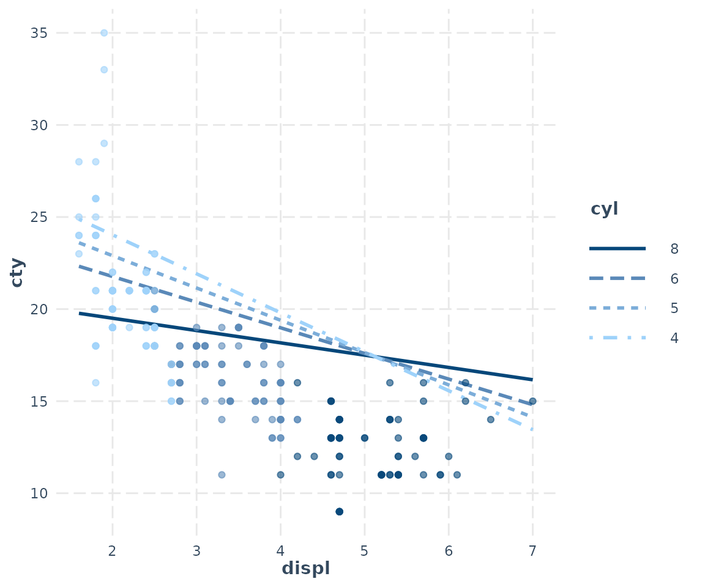

Hmm, doesn’t that look…bad? You can kind of see the pattern of the
interaction, but the predicted lines don’t seem to match the data very
well. But I included a lot of variables besides `cyl` and `displ` in
this model and they may be accounting for some of this variation. This
is what *partial residual plots* are designed to help with. You can
learn more about the technique and theory in Fox and Weisberg (2018) and
another place to generate partial residual plots is in Fox’s `effects`
package.

Using the argument `partial.residuals = TRUE`, what is plotted instead
is the observed data *with the effects of all the control variables
accounted for*. In other words, the value `cty` for the observed data is
based only on the values of `displ`, `cyl`, and the model error. Let’s
take a look.

``` r

interact_plot(fitc, pred = displ, modx = cyl, partial.residuals = TRUE,
              modx.values = c(4, 5, 6, 8))
```

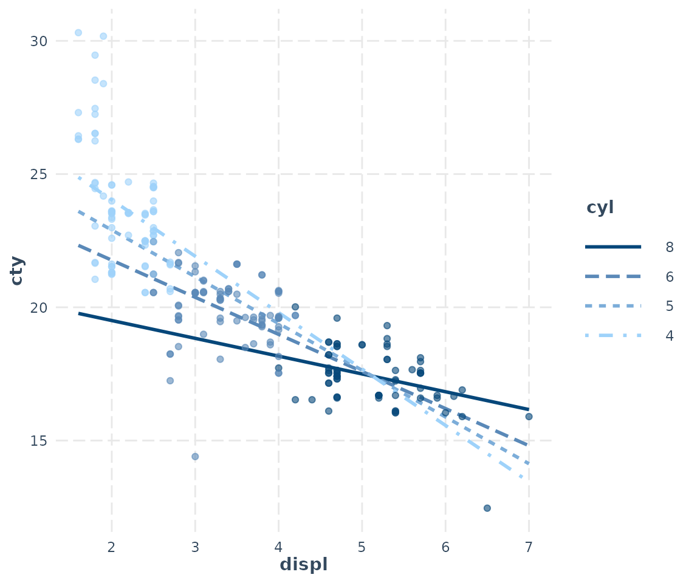

Now we can understand how the observed data and the model relate to each
other much better. One insight is how the model really underestimates
the values at the low end of displacement and cylinders. You can also
see how much the cylinders and displacement seem to be correlated each
other, which makes it difficult to say how much we can learn from this
kind of model.

### Confidence bands

Another way to get a sense of the precision of the estimates is by
plotting confidence bands. To get started, just set `interval = TRUE`.
To decide how wide the confidence interval should be, express the
percentile as a number, e.g., `int.width = 0.8` corresponds to an 80%
interval.

``` r

interact_plot(fiti, pred = Illiteracy, modx = Murder, interval = TRUE,
              int.width = 0.8)
```

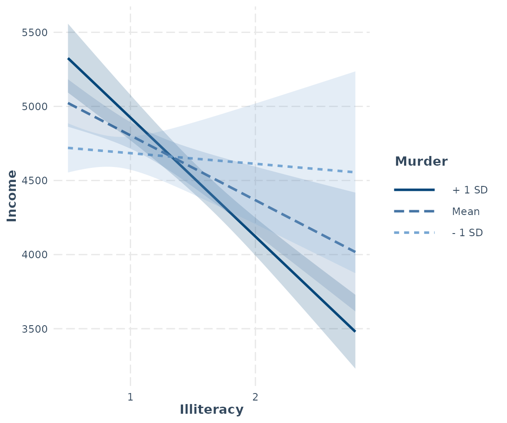

You can also use the `robust` argument to plot confidence intervals
based on robust standard error calculations.

### Check linearity assumption

A basic assumption of linear regression is that the relationship between
the predictors and response variable is linear. When you have an
interaction effect, you add the assumption that relationship between
your predictor and response is linear regardless of the level of the
moderator.

To show a striking example of how this can work, we’ll generate two
simple datasets to replicate Hainmueller et al. (2017).

The first has a focal predictor $`X`$ that is normally distributed with
mean 3 and standard deviation 1. It then has a dichotomous moderator
$`W`$ that is Bernoulli distributed with mean probability 0.5. We also
generate a normally distributed error term with standard deviation 4.

``` r

set.seed(99)
x <- rnorm(n = 200, mean = 3, sd = 1)
err <- rnorm(n = 200, mean = 0, sd = 4)
w <- rbinom(n = 200, size = 1, prob = 0.5)

y_1 <- 5 - 4*x - 9*w + 3*w*x + err
```

We fit a linear regression model with an interaction between x and w.

``` r

model_1 <- lm(y_1 ~ x * w)
summ(model_1)
```

    ## MODEL INFO:
    ## Observations: 200
    ## Dependent Variable: y_1
    ## Type: OLS linear regression 
    ## 
    ## MODEL FIT:
    ## F(3,196) = 25.93, p = 0.00
    ## R² = 0.28
    ## Adj. R² = 0.27 
    ## 
    ## Standard errors:OLS
    ## ------------------------------------------------
    ##                      Est.   S.E.   t val.      p
    ## ----------------- ------- ------ -------- ------
    ## (Intercept)          3.19   1.29     2.47   0.01
    ## x                   -3.59   0.42    -8.61   0.00
    ## w                   -7.77   1.90    -4.10   0.00
    ## x:w                  2.86   0.62     4.62   0.00
    ## ------------------------------------------------

In the following plot, we use `linearity.check = TRUE` argument to split
the data by the level of the moderator $`W`$ and plot predicted lines
(black) and a loess line (red) within each group. The predicted lines
come from the full data set. The loess line looks only at the subset of
data in each pane and will be curved if the relationship is nonlinear.
What we’re looking for is whether the red loess line is straight like
the predicted line.

``` r

interact_plot(model_1, pred = x, modx = w, linearity.check = TRUE, 
              plot.points = TRUE)
```

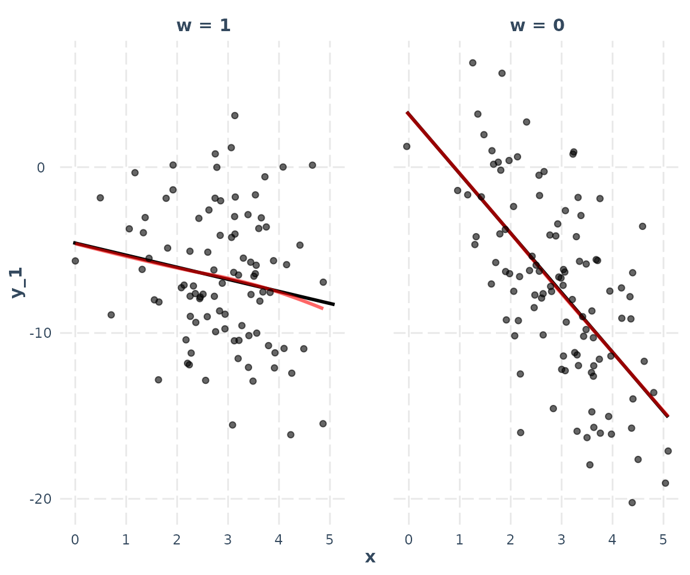

In this case, it is. That means the assumption is satisfied.

Now we generate similar data, but this time the linearity assumption
will be violated. $`X_2`$ will now be uniformly distributed across the
range of -3 to 3. The true relationship between `y_2` and $`X_2`$
(`x_2`) is non-linear.

``` r

x_2 <- runif(n = 200, min = -3, max = 3)
y_2 <- 2.5 - x_2^2 - 5*w + 2*w*(x_2^2) + err
data_2 <- as.data.frame(cbind(x_2, y_2, w))

model_2 <- lm(y_2 ~ x_2 * w, data = data_2)
summ(model_2)
```

    ## MODEL INFO:
    ## Observations: 200
    ## Dependent Variable: y_2
    ## Type: OLS linear regression 
    ## 
    ## MODEL FIT:
    ## F(3,196) = 3.28, p = 0.02
    ## R² = 0.05
    ## Adj. R² = 0.03 
    ## 
    ## Standard errors:OLS
    ## ------------------------------------------------
    ##                      Est.   S.E.   t val.      p
    ## ----------------- ------- ------ -------- ------
    ## (Intercept)         -0.75   0.49    -1.51   0.13
    ## x_2                  0.53   0.30     1.77   0.08
    ## w                    1.63   0.72     2.28   0.02
    ## x_2:w               -0.25   0.42    -0.61   0.54
    ## ------------------------------------------------

The regression output would lead us to believe there is no interaction.

Let’s do the linearity check:

``` r

interact_plot(model_2, pred = x_2, modx = w, linearity.check = TRUE, 
              plot.points = TRUE)
```

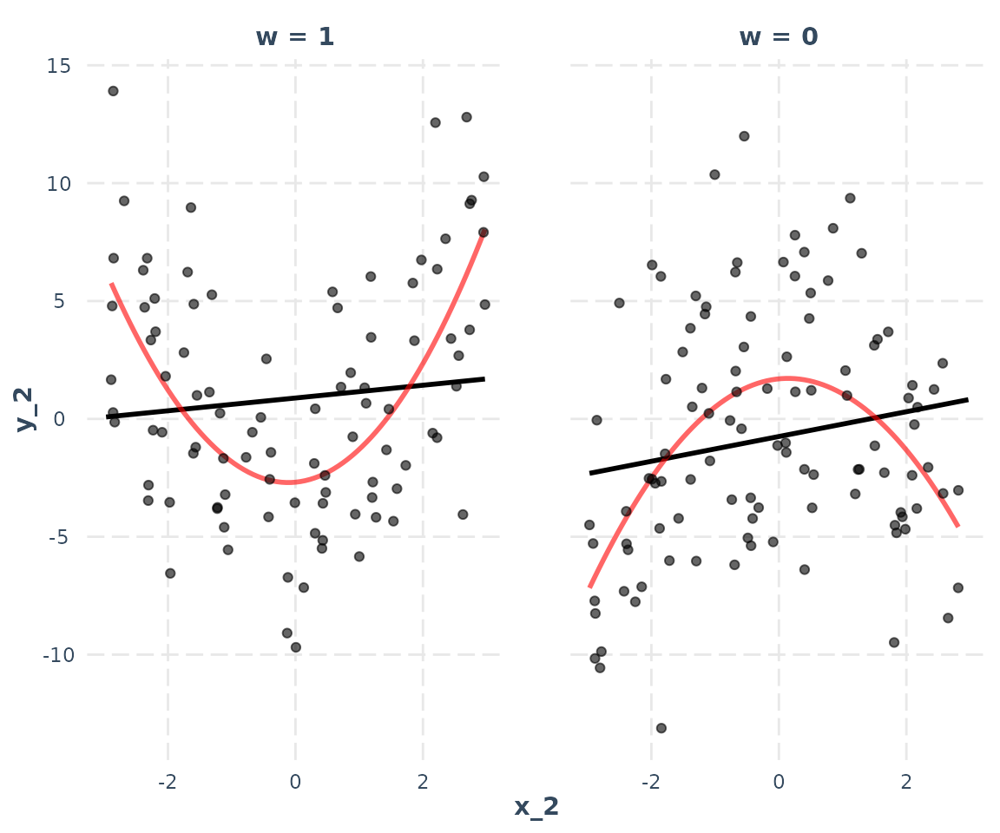

This is a striking example of the assumption being violated. At both
levels of $`W`$, the relationship between $`X_2`$ and the response is
non-linear. There really is an interaction, but it’s a non-linear one.

You could try to fit this true model with the polynomial term like this:

``` r

model_3 <- lm(y_2 ~ poly(x_2, 2) * w, data = data_2)
summ(model_3)
```

    ## MODEL INFO:
    ## Observations: 200
    ## Dependent Variable: y_2
    ## Type: OLS linear regression 
    ## 
    ## MODEL FIT:
    ## F(5,194) = 18.32, p = 0.00
    ## R² = 0.32
    ## Adj. R² = 0.30 
    ## 
    ## Standard errors:OLS
    ## -----------------------------------------------------
    ##                           Est.   S.E.   t val.      p
    ## --------------------- -------- ------ -------- ------
    ## (Intercept)              -1.01   0.42    -2.41   0.02
    ## poly(x_2, 2)1             9.90   6.14     1.61   0.11
    ## poly(x_2, 2)2           -34.14   6.15    -5.55   0.00
    ## w                         1.61   0.61     2.65   0.01
    ## poly(x_2, 2)1:w          -6.33   8.60    -0.74   0.46
    ## poly(x_2, 2)2:w          75.58   8.62     8.77   0.00
    ## -----------------------------------------------------

`interact_plot` can plot these kinds of effects, too. Just provide the
untransformed predictor’s name (in this case, `x_2`) and also include
the data in the `data` argument. If you don’t include the data, the
function will try to find the data you used but it will warn you about
it and it could cause problems under some circumstances.

``` r

interact_plot(model_3, pred = x_2, modx = w, data = data_2)
```

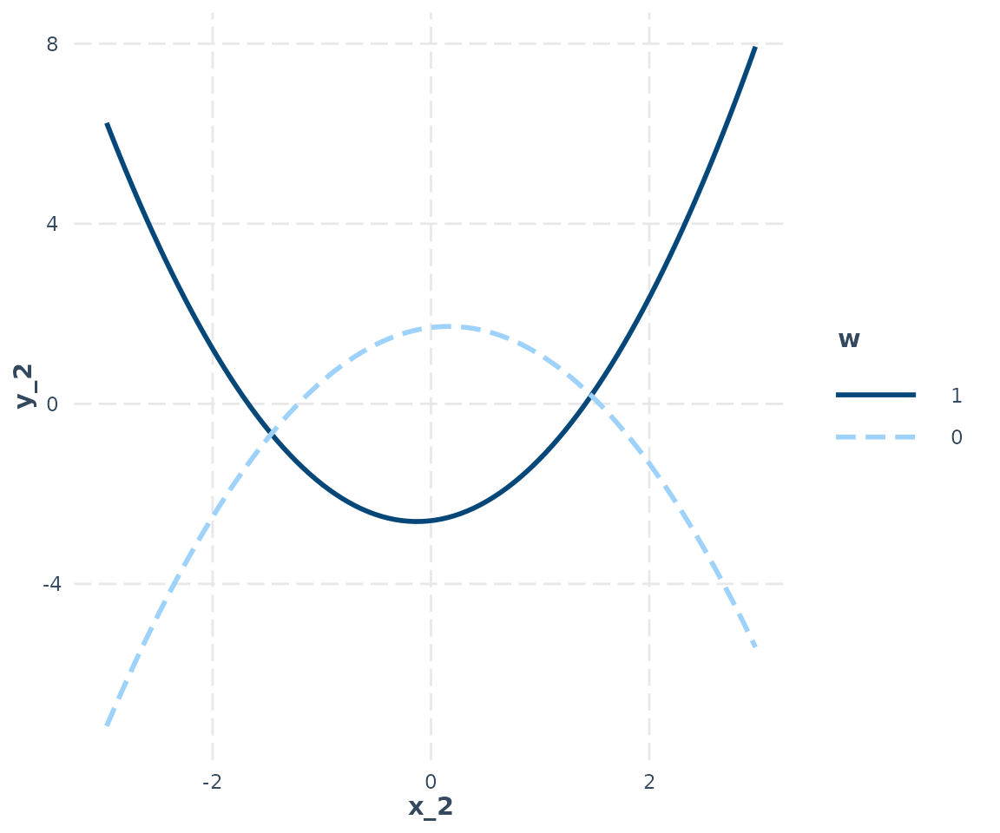

Look familiar? Let’s do the linearity.check, which in this case is more
like a non-linearity check:

``` r

interact_plot(model_3, pred = x_2, modx = w, data = data_2,
              linearity.check = TRUE, plot.points = TRUE)
```

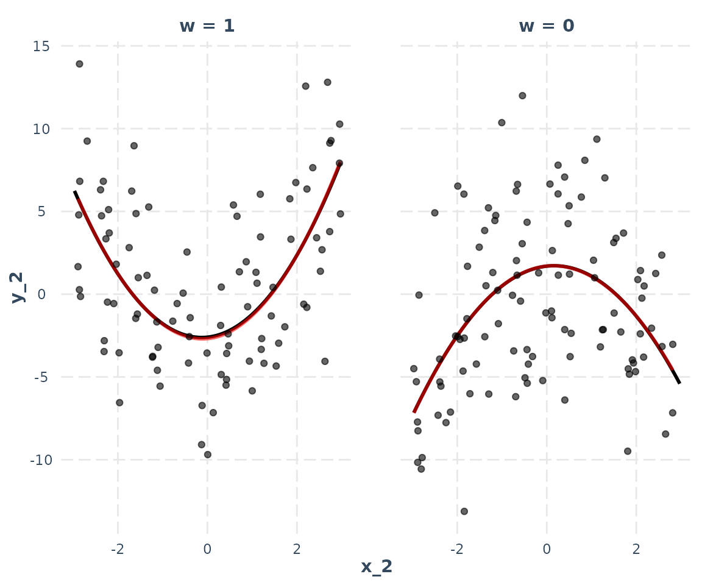

The red loess line almost perfectly overlaps the black predicted line,
indicating the assumption is satisfied. As a note of warning, in
practice the lines will rarely overlap so neatly and you will have to
make more difficult judgment calls.

### Other options

There are a number of other options not mentioned, many relating to the
appearance.

For instance, you can manually specify the axis labels, add a main
title, choose a color scheme, and so on.

``` r

interact_plot(fiti, pred = Illiteracy, modx = Murder,
              x.label = "Custom X Label", y.label = "Custom Y Label",
              main.title = "Sample Plot",  legend.main = "Custom Legend Title",
              colors = "seagreen")
```

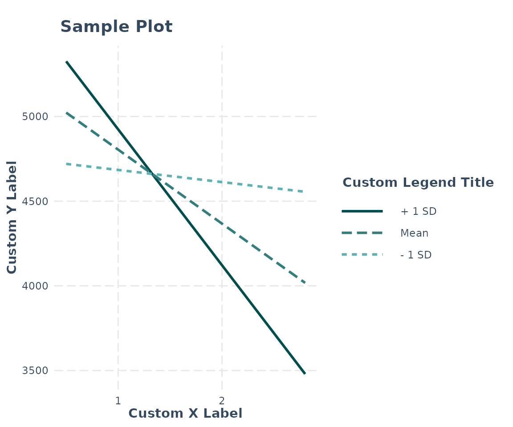

Because the function uses `ggplot2`, it can be modified and extended
like any other `ggplot2` object. For example, using the `theme_apa`
function from `jtools`:

``` r

interact_plot(fitiris, pred = Petal.Width, modx = Species) + theme_apa()
```

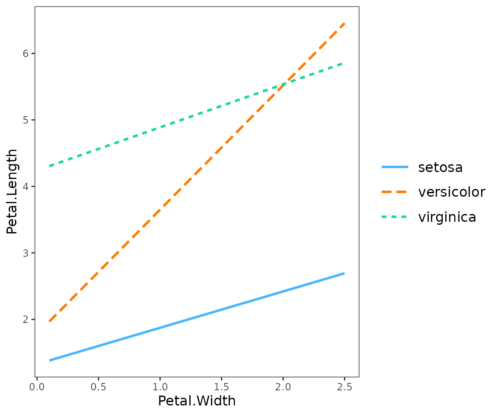

## Simple slopes analysis and Johnson-Neyman intervals

Simple slopes analysis gives researchers a way to express the
interaction effect in terms that are easy to understand to those who
know how to interpret direct effects in regression models. This method
is designed for **continuous variable by continuous variable**
interactions, but can work when the moderator is binary.

In simple slopes analysis, researchers are interested in the
*conditional* slope of the focal predictor; that is, what is the slope
of the predictor when the moderator is held at some particular value?
The regression output we get when including the interaction term tells
us what the slope is when the moderator is held at zero, which is often
not a practically/theoretically meaningful value. To better understand
the nature of the interaction, simple slopes analysis allows the
researcher to specify meaningful values at which to hold the moderator
value.

While the computation behind doing so isn’t exactly rocket science, it
is inconvenient and prone to error. The `sim_slopes` function from
`interactions` accepts a regression model (with an interaction term) as
an input and automates the simple slopes procedure. The function will,
by default, do the following:

- Mean-center all non-focal predictors (so that setting them to zero
  means setting them to their mean)
- For continuous moderators, it will choose the mean as well as the mean
  plus/minus 1 standard deviation as values at which to find the slope
  of the focal predictor.
- For categorical/binary moderators, it will find the slope of the focal
  predictor at each level of the moderator.

In its most basic use case, `sim_slopes` needs three arguments: a
regression model, the name of the focal predictor as the argument for
`pred =`, and the name of the moderator as the argument for `modx =`.
Let’s go through an example.

Now let’s do the most basic simple slopes analysis:

``` r

sim_slopes(fiti, pred = Illiteracy, modx = Murder, johnson_neyman = FALSE)
```

    ## SIMPLE SLOPES ANALYSIS
    ## 
    ## Slope of Illiteracy when Murder =  5.420973 (- 1 SD): 
    ## 
    ##     Est.     S.E.   t val.      p
    ## -------- -------- -------- ------
    ##   -71.59   268.65    -0.27   0.79
    ## 
    ## Slope of Illiteracy when Murder =  8.685043 (Mean): 
    ## 
    ##      Est.     S.E.   t val.      p
    ## --------- -------- -------- ------
    ##   -437.12   175.82    -2.49   0.02
    ## 
    ## Slope of Illiteracy when Murder = 11.949113 (+ 1 SD): 
    ## 
    ##      Est.     S.E.   t val.      p
    ## --------- -------- -------- ------
    ##   -802.66   145.72    -5.51   0.00

So what we see in this example is that when the value of `Murder` is
high, the slope of `Illiteracy` is negative and significantly different
from zero. The value for `Illiteracy` when `Murder` is high is in the
opposite direction from its coefficient estimate for the first version
of the model fit with `lm` but this result makes sense considering the
interaction coefficient was negative; it means that as one of the
variables goes up, the other goes down. Now we know the effect of
`Illiteracy` only exists when `Murder` is high.

You may also choose the values of the moderator yourself with the
`modx.values =` argument.

``` r

sim_slopes(fiti, pred = Illiteracy, modx = Murder, modx.values = c(0, 5, 10),
           johnson_neyman = FALSE)
```

    ## SIMPLE SLOPES ANALYSIS
    ## 
    ## Slope of Illiteracy when Murder =  0.00: 
    ## 
    ##     Est.     S.E.   t val.      p
    ## -------- -------- -------- ------
    ##   535.50   458.77     1.17   0.25
    ## 
    ## Slope of Illiteracy when Murder =  5.00: 
    ## 
    ##     Est.     S.E.   t val.      p
    ## -------- -------- -------- ------
    ##   -24.44   282.48    -0.09   0.93
    ## 
    ## Slope of Illiteracy when Murder = 10.00: 
    ## 
    ##      Est.     S.E.   t val.      p
    ## --------- -------- -------- ------
    ##   -584.38   152.37    -3.84   0.00

Bear in mind that these estimates are managed by refitting the models.
If the model took a long time to fit the first time, expect a long run
time for `sim_slopes`.

#### Visualize the coefficients

Similar to what this package’s `plot_coefs`/`plot_summs` functions
offer, you can save your `sim_slopes` output to an object and call
`plot` on that object.

``` r

ss <- sim_slopes(fiti, pred = Illiteracy, modx = Murder, 
                 modx.values = c(0, 5, 10))
plot(ss)
```

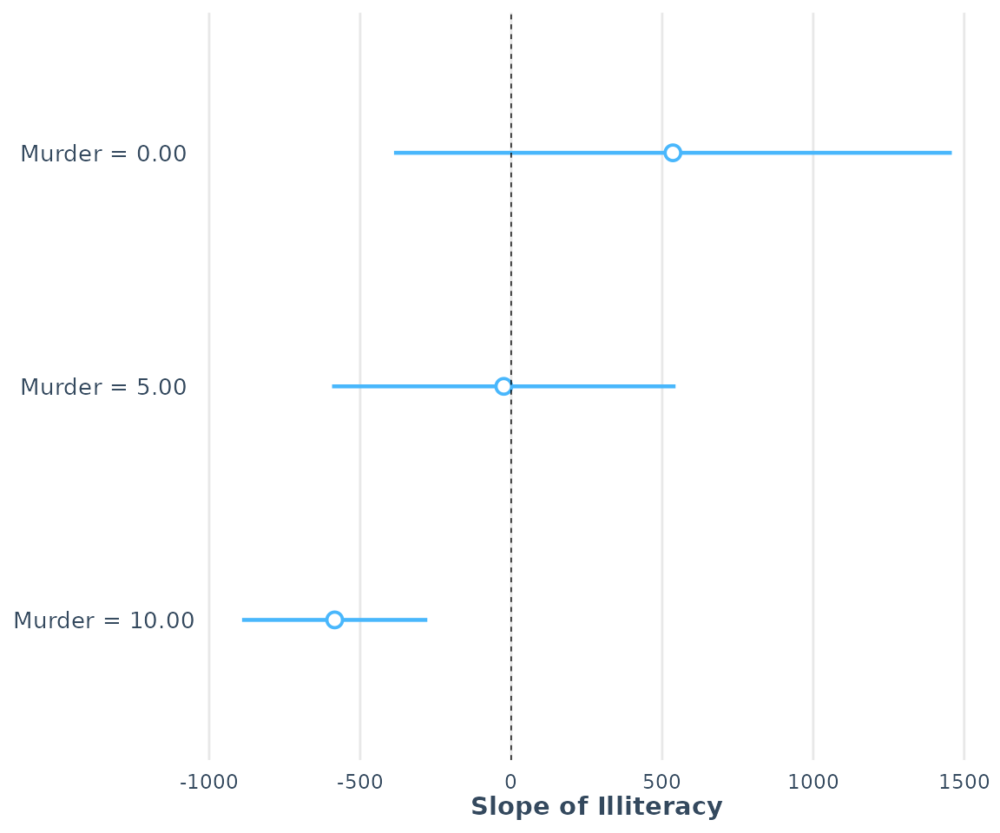

#### Tabular output

You can also use the `huxtable` package to get a publication-style table
from your `sim_slopes` output.

``` r

ss <- sim_slopes(fiti, pred = Illiteracy, modx = Murder,
                 modx.values = c(0, 5, 10))
library(huxtable)
as_huxtable(ss)
```

| Value of Murder | Slope of Illiteracy    |
|-----------------|------------------------|
| 0.00            | 535.50 (458.77)        |
| 5.00            | -24.44 (282.48)        |
| 10.00           | -584.38 (152.37)\*\*\* |

#### Johnson-Neyman intervals

Did you notice how I was adding the argument `johnson_neyman = FALSE`
above? That’s because by default, `sim_slopes` will also calculate what
is called the Johnson-Neyman interval. This tells you *all* the values
of the moderator for which the slope of the predictor will be
statistically significant. Depending on the specific analysis, it may be
that all values of the moderator **outside** of the interval will have a
significant slope for the predictor. Other times, it will only be values
**inside** the interval—you will have to look at the output to see.

It can take a moment to interpret this correctly if you aren’t familiar
with the Johnson-Neyman technique. But if you read the output carefully
and take it literally, you’ll get the hang of it.

``` r

sim_slopes(fiti, pred = Illiteracy, modx = Murder, johnson_neyman = TRUE)
```

    ## JOHNSON-NEYMAN INTERVAL
    ## 
    ## When Murder is OUTSIDE the interval [-10.61, 8.16], the slope of
    ## Illiteracy is p < .05.
    ## 
    ## Note: The range of observed values of Murder is [1.40, 15.10]
    ## 
    ## SIMPLE SLOPES ANALYSIS
    ## 
    ## Slope of Illiteracy when Murder =  5.420973 (- 1 SD): 
    ## 
    ##     Est.     S.E.   t val.      p
    ## -------- -------- -------- ------
    ##   -71.59   268.65    -0.27   0.79
    ## 
    ## Slope of Illiteracy when Murder =  8.685043 (Mean): 
    ## 
    ##      Est.     S.E.   t val.      p
    ## --------- -------- -------- ------
    ##   -437.12   175.82    -2.49   0.02
    ## 
    ## Slope of Illiteracy when Murder = 11.949113 (+ 1 SD): 
    ## 
    ##      Est.     S.E.   t val.      p
    ## --------- -------- -------- ------
    ##   -802.66   145.72    -5.51   0.00

In the example above, we can see that the Johnson-Neyman interval and
the simple slopes analysis agree—they always will. The benefit of the
J-N interval is it will tell you exactly where the predictor’s slope
becomes significant/insignificant at a specified alpha level.

You can also call the `johnson_neyman` function directly if you want to
do something like tweak the alpha level. The `johnson_neyman` function
will also create a plot by default — you can get them by setting
`jnplot = TRUE` with `sim_slopes`.

``` r

johnson_neyman(fiti, pred = Illiteracy, modx = Murder, alpha = .05)
```

    ## JOHNSON-NEYMAN INTERVAL
    ## 
    ## When Murder is OUTSIDE the interval [-10.61, 8.16], the slope of
    ## Illiteracy is p < .05.
    ## 
    ## Note: The range of observed values of Murder is [1.40, 15.10]

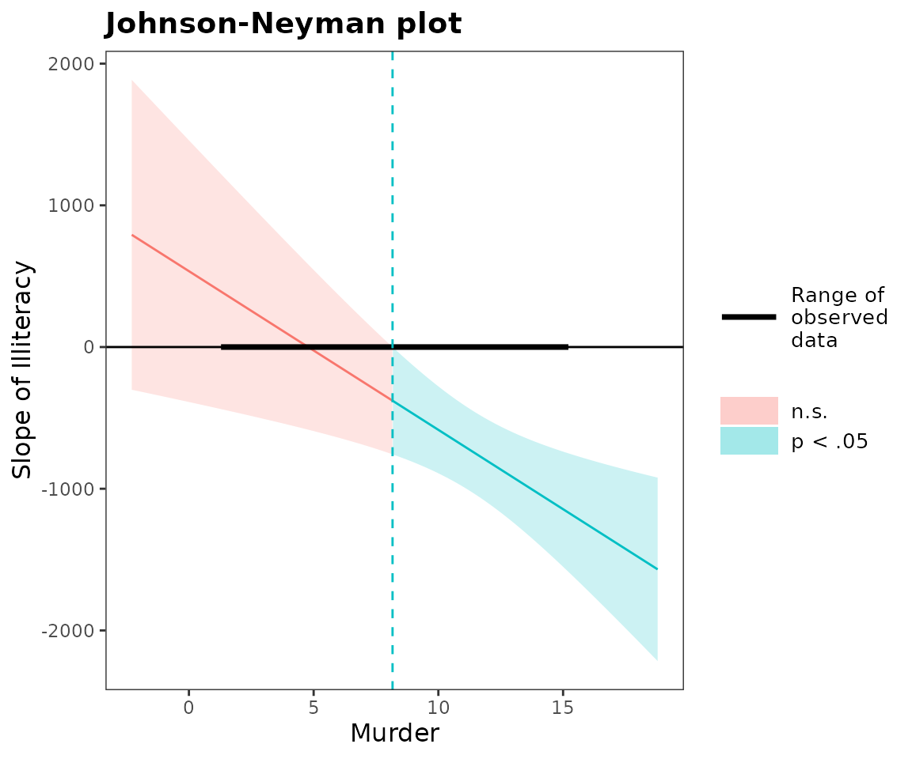

*A note on Johnson-Neyman plots*: Once again, it is easy to misinterpret
the meaning. Notice that the y-axis is the **conditional slope** of the
predictor. The plot shows you where the conditional slope differs
significantly from zero. In the plot above, we see that from the point
Murder (the moderator) = 9.12 and greater, the slope of Illiteracy (the
predictor) is significantly different from zero and in this case
negative. The lower bound for this interval (about -32) is so far
outside the observed data that it is not plotted. If you could have -32
as a value for Murder rate, though, that would be the other threshold
before which the slope of Illiteracy would become positive.

The purpose of reminding you both within the plot and the printed output
of the range of observed data is to help you put the results in context;
in this case, the only justifiable interpretation is that Illiteracy has
no effect on the outcome variable except when Murder is higher than
8.16. You wouldn’t interpret the lower boundary because your dataset
doesn’t contain any values near it.

#### False discovery rate adjustment

A recent publication (Esarey & Sumner, 2017) explored ways to calculate
the Johnson-Neyman interval that properly manages the Type I and II
error rates. Others have noted that the alpha level implied by the
Johnson-Neyman interval won’t be quite right (e.g., Bauer & Curran,
2005), but there hasn’t been any general solution that has gotten wide
acceptance in the research literature just yet.

The basic problem is that the Johnson-Neyman interval is essentially
doing a bunch of comparisons across all the values of the moderator,
each one inflating the Type I error rate. The issue isn’t so much that
you can’t possibly address it, but many solutions are far too
conservative and others aren’t broadly applicable. Esarey and Sumner
(2017), among other contributions, suggested an adjustment that seems to
do a good job of balancing the desire to be a conservative test without
missing a lot of true effects in the process. I won’t go into the
details here. The implementation in `johnson_neyman` is based on code
adapted from Esarey and Sumner’s `interactionTest` package, but any
errors should be assumed to be from `interactions`, not them.

To use this feature, simply set `control.fdr = TRUE` in the call to
`johnson_neyman` or `sim_slopes`.

``` r

sim_slopes(fiti, pred = Illiteracy, modx = Murder, johnson_neyman = TRUE,
           control.fdr = TRUE)
```

    ## JOHNSON-NEYMAN INTERVAL
    ## 
    ## When Murder is OUTSIDE the interval [-22.57, 8.52], the slope of
    ## Illiteracy is p < .05.
    ## 
    ## Note: The range of observed values of Murder is [1.40, 15.10]
    ## 
    ## Interval calculated using false discovery rate adjusted t = 2.33 
    ## 
    ## SIMPLE SLOPES ANALYSIS
    ## 
    ## Slope of Illiteracy when Murder =  5.420973 (- 1 SD): 
    ## 
    ##     Est.     S.E.   t val.      p
    ## -------- -------- -------- ------
    ##   -71.59   268.65    -0.27   0.79
    ## 
    ## Slope of Illiteracy when Murder =  8.685043 (Mean): 
    ## 
    ##      Est.     S.E.   t val.      p
    ## --------- -------- -------- ------
    ##   -437.12   175.82    -2.49   0.02
    ## 
    ## Slope of Illiteracy when Murder = 11.949113 (+ 1 SD): 
    ## 
    ##      Est.     S.E.   t val.      p
    ## --------- -------- -------- ------
    ##   -802.66   145.72    -5.51   0.00

In this case, you can see that the interval is just a little bit wider.
The output reports the adjusted test statistic, which is 2.33, not much
different than the (approximately) 2 that would be used otherwise. In
other cases it may be quite a bit larger.

### Additional options

#### Conditional intercepts

Sometimes it is informative to know the conditional intercepts in
addition to the slopes. It might be interesting to you that individuals
low on the moderator have a positive slope and individuals high on it
don’t, but that doesn’t mean that individuals low on the moderator will
have higher values of the dependent variable. You would only know that
if you know the conditional intercept. Plotting is an easy way to notice
this, but you can do it with the console output as well.

You can print the conditional intercepts with the `cond.int = TRUE`
argument.

``` r

sim_slopes(fiti, pred = Illiteracy, modx = Murder, cond.int = TRUE)
```

    ## JOHNSON-NEYMAN INTERVAL
    ## 
    ## When Murder is OUTSIDE the interval [-10.61, 8.16], the slope of
    ## Illiteracy is p < .05.
    ## 
    ## Note: The range of observed values of Murder is [1.40, 15.10]
    ## 
    ## SIMPLE SLOPES ANALYSIS
    ## 
    ## When Murder =  5.420973 (- 1 SD): 
    ## 
    ##                                  Est.     S.E.   t val.      p
    ## --------------------------- --------- -------- -------- ------
    ## Slope of Illiteracy            -71.59   268.65    -0.27   0.79
    ## Conditional intercept         4755.88   247.48    19.22   0.00
    ## 
    ## When Murder =  8.685043 (Mean): 
    ## 
    ##                                  Est.     S.E.   t val.      p
    ## --------------------------- --------- -------- -------- ------
    ## Slope of Illiteracy           -437.12   175.82    -2.49   0.02
    ## Conditional intercept         5241.43   202.73    25.85   0.00
    ## 
    ## When Murder = 11.949113 (+ 1 SD): 
    ## 
    ##                                  Est.     S.E.   t val.      p
    ## --------------------------- --------- -------- -------- ------
    ## Slope of Illiteracy           -802.66   145.72    -5.51   0.00
    ## Conditional intercept         5726.98   246.24    23.26   0.00

This example shows you that while the slope associated with `Illiteracy`
is negative when `Murder` is high, the conditional intercept is also
high when `Murder` is high. That tells you that increases in
`Illiteracy` for high-`Murder` observations will tend towards being
equal on `Income` to observations with lower values of `Murder`.

#### Robust standard errors

Certain models require heteroskedasticity-robust standard errors. To be
consistent with the reporting of heteroskedasticity-robust standard
errors offered by `summ`, `sim_slopes` will do the same with the use of
the `robust` option so you can consistently report standard errors
across models.

``` r

sim_slopes(fiti, pred = Illiteracy, modx = Murder, robust = "HC3")
```

    ## JOHNSON-NEYMAN INTERVAL
    ## 
    ## When Murder is OUTSIDE the interval [-6.13, 8.31], the slope of
    ## Illiteracy is p < .05.
    ## 
    ## Note: The range of observed values of Murder is [1.40, 15.10]
    ## 
    ## SIMPLE SLOPES ANALYSIS
    ## 
    ## Slope of Illiteracy when Murder =  5.420973 (- 1 SD): 
    ## 
    ##     Est.     S.E.   t val.      p
    ## -------- -------- -------- ------
    ##   -71.59   256.60    -0.28   0.78
    ## 
    ## Slope of Illiteracy when Murder =  8.685043 (Mean): 
    ## 
    ##      Est.     S.E.   t val.      p
    ## --------- -------- -------- ------
    ##   -437.12   191.07    -2.29   0.03
    ## 
    ## Slope of Illiteracy when Murder = 11.949113 (+ 1 SD): 
    ## 
    ##      Est.     S.E.   t val.      p
    ## --------- -------- -------- ------
    ##   -802.66   178.75    -4.49   0.00

These data are a relatively rare case in which the robust standard
errors are even more efficient than typical OLS standard errors. Note
that you must have the `sandwich` package installed to use this feature.

#### Centering variables

By default, all non-focal variables are mean-centered. You may also
request that no variables be centered with `centered = "none"`. You may
also request specific variables to center by providing a vector of
quoted variable names — no others will be centered in that case.

Note that the moderator is centered around the specified values. Factor
variables are ignored in the centering process and just held at their
observed values.

## Do simple slopes and plotting with one function

You won’t have to use these functions long before you may find yourself
using both of them for each model you want to explore. To streamline the
process, this package offers
[`probe_interaction()`](https://interactions.jacob-long.com/reference/probe_interaction.md)
as a convenience function that calls both
[`sim_slopes()`](https://interactions.jacob-long.com/reference/sim_slopes.md)
and
[`interact_plot()`](https://interactions.jacob-long.com/reference/interact_plot.md),
taking advantage of their overlapping syntax.

``` r

library(survey)
data(api)
dstrat <- svydesign(id = ~1, strata = ~stype, weights = ~pw,
                    data = apistrat, fpc = ~fpc)
regmodel <- svyglm(api00 ~ avg.ed * growth, design = dstrat)

probe_interaction(regmodel, pred = growth, modx = avg.ed, cond.int = TRUE,
                  interval = TRUE,  jnplot = TRUE)
```

    ## JOHNSON-NEYMAN INTERVAL
    ## 
    ## When avg.ed is OUTSIDE the interval [3.11, 5.78], the slope of
    ## growth is p < .05.
    ## 
    ## Note: The range of observed values of avg.ed is [1.38, 4.44]

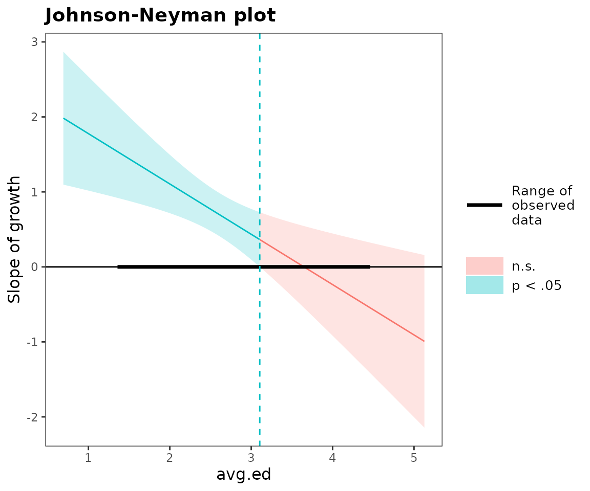

    ## SIMPLE SLOPES ANALYSIS
    ## 
    ## When avg.ed = 2.085002 (- 1 SD): 
    ## 
    ##                                 Est.    S.E.   t val.      p
    ## --------------------------- -------- ------- -------- ------
    ## Slope of growth                 1.05    0.19     5.66   0.00
    ## Conditional intercept         521.23   11.20    46.54   0.00
    ## 
    ## When avg.ed = 2.787381 (Mean): 
    ## 
    ##                                 Est.   S.E.   t val.      p
    ## --------------------------- -------- ------ -------- ------
    ## Slope of growth                 0.58   0.15     3.80   0.00
    ## Conditional intercept         639.78   6.80    94.09   0.00
    ## 
    ## When avg.ed = 3.489761 (+ 1 SD): 
    ## 
    ##                                 Est.   S.E.   t val.      p
    ## --------------------------- -------- ------ -------- ------
    ## Slope of growth                 0.11   0.25     0.43   0.67
    ## Conditional intercept         758.34   6.85   110.66   0.00

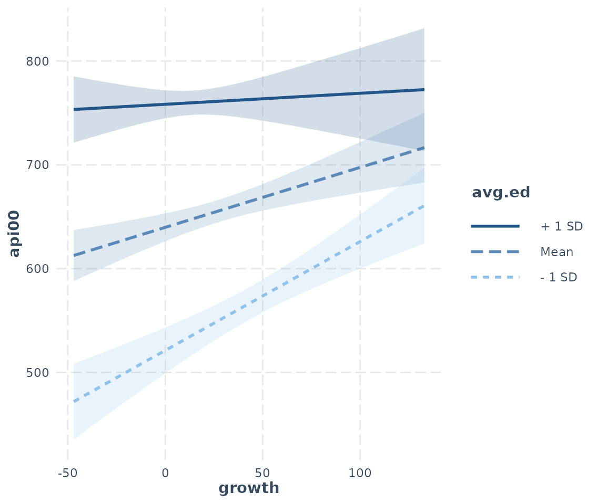

Note in the above example that you can provide arguments that only apply
to one function and they will be used appropriately. On the other hand,
you cannot apply their overlapping functions selectively. That is, you
can’t have one `centered = "all"` and the other `centered = "none"`. If
you want that level of control, just call each function separately.

It returns an object with each of the two functions’ return objects:

``` r

out <- probe_interaction(regmodel, pred = growth, modx = avg.ed,
                         cond.int = TRUE, interval = TRUE, jnplot = TRUE)
names(out)
```

    ## [1] "simslopes"    "interactplot"

Also, the above example comes from the survey package as a means to show
that, yes, these tools can be used with `svyglm` objects. It is also
tested with `glm`, `merMod`, and `rq` models, though you should always
do your homework to decide whether these procedures are appropriate in
those cases.

## 3-way interactions

If 2-way interactions can be hard to grasp by looking at regular
regression output, then 3-way interactions are outright inscrutable. The
aforementioned functions also support 3-way interactions, however.
Plotting these effects is particularly helpful.

Note that Johnson-Neyman intervals are still provided, but only insofar
as you get the intervals for chosen levels of the second moderator. This
does go against some of the distinctiveness of the J-N technique, which
for 2-way interactions is a way to avoid having to choose points of the
moderator to check whether the predictor has a significant slope.

``` r

fita3 <- lm(rating ~ privileges * critical * learning, data = attitude)
probe_interaction(fita3, pred = critical, modx = learning, mod2 = privileges,
                  alpha = .1)
```

    ## █████████████ While privileges (2nd moderator) = 40.89790 (- 1 SD) █████████████ 
    ## 
    ## JOHNSON-NEYMAN INTERVAL
    ## 
    ## When learning is INSIDE the interval [49.48, 161.86], the slope of
    ## critical is p < .1.
    ## 
    ## Note: The range of observed values of learning is [34.00, 75.00]
    ## 
    ## SIMPLE SLOPES ANALYSIS
    ## 
    ## Slope of critical when learning = 44.62965 (- 1 SD): 
    ## 
    ##   Est.   S.E.   t val.      p
    ## ------ ------ -------- ------
    ##   0.24   0.24     1.02   0.32
    ## 
    ## Slope of critical when learning = 56.36667 (Mean): 
    ## 
    ##   Est.   S.E.   t val.      p
    ## ------ ------ -------- ------
    ##   0.68   0.33     2.05   0.05
    ## 
    ## Slope of critical when learning = 68.10368 (+ 1 SD): 
    ## 
    ##   Est.   S.E.   t val.      p
    ## ------ ------ -------- ------
    ##   1.11   0.55     2.01   0.06
    ## 
    ## ██████████████ While privileges (2nd moderator) = 53.13333 (Mean) ██████████████ 
    ## 
    ## JOHNSON-NEYMAN INTERVAL
    ## 
    ## The Johnson-Neyman interval could not be found. Is the p value for your
    ## interaction term below the specified alpha?
    ## 
    ## SIMPLE SLOPES ANALYSIS
    ## 
    ## Slope of critical when learning = 44.62965 (- 1 SD): 
    ## 
    ##   Est.   S.E.   t val.      p
    ## ------ ------ -------- ------
    ##   0.09   0.34     0.27   0.79
    ## 
    ## Slope of critical when learning = 56.36667 (Mean): 
    ## 
    ##   Est.   S.E.   t val.      p
    ## ------ ------ -------- ------
    ##   0.06   0.24     0.24   0.81
    ## 
    ## Slope of critical when learning = 68.10368 (+ 1 SD): 
    ## 
    ##   Est.   S.E.   t val.      p
    ## ------ ------ -------- ------
    ##   0.02   0.33     0.07   0.95
    ## 
    ## █████████████ While privileges (2nd moderator) = 65.36876 (+ 1 SD) █████████████ 
    ## 
    ## JOHNSON-NEYMAN INTERVAL
    ## 
    ## The Johnson-Neyman interval could not be found. Is the p value for your
    ## interaction term below the specified alpha?
    ## 
    ## SIMPLE SLOPES ANALYSIS
    ## 
    ## Slope of critical when learning = 44.62965 (- 1 SD): 
    ## 
    ##    Est.   S.E.   t val.      p
    ## ------- ------ -------- ------
    ##   -0.06   0.61    -0.09   0.93
    ## 
    ## Slope of critical when learning = 56.36667 (Mean): 
    ## 
    ##    Est.   S.E.   t val.      p
    ## ------- ------ -------- ------
    ##   -0.56   0.50    -1.12   0.28
    ## 
    ## Slope of critical when learning = 68.10368 (+ 1 SD): 
    ## 
    ##    Est.   S.E.   t val.      p
    ## ------- ------ -------- ------
    ##   -1.06   0.66    -1.62   0.12

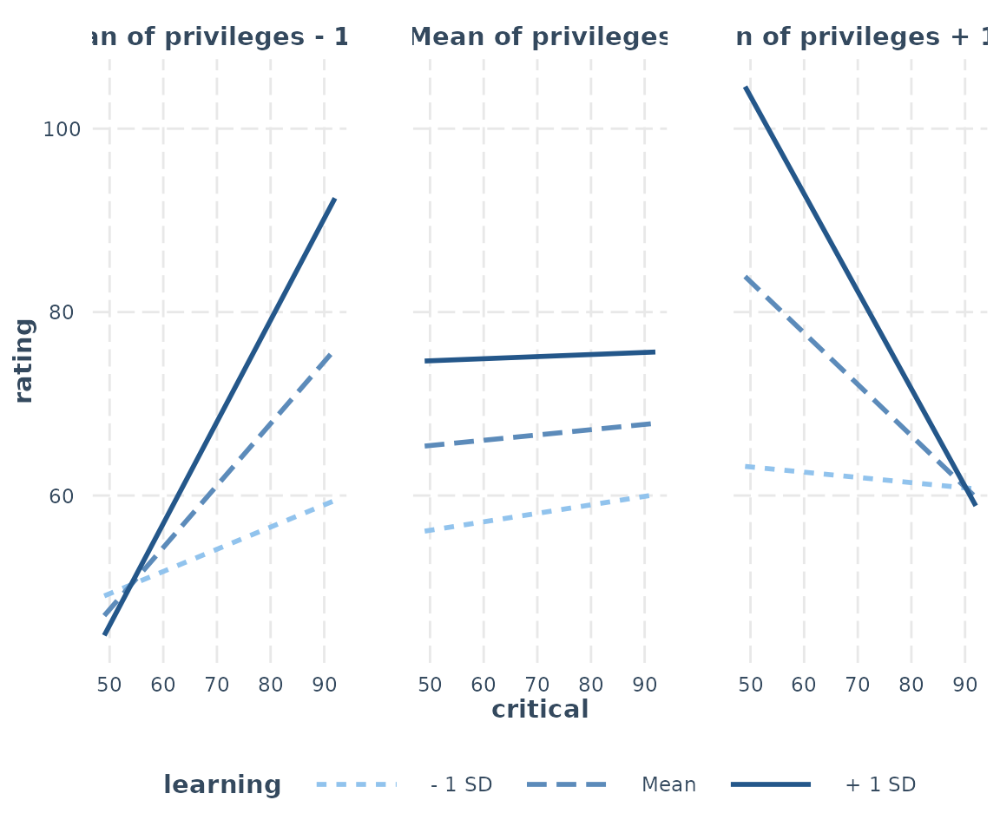

You can change the labels for each plot via the `mod2.labels` argument.

And don’t forget that you can use `theme_apa` to format for publications
or just to make more economical use of space.

``` r

mtcars$cyl <- factor(mtcars$cyl,
                     labels = c("4 cylinder", "6 cylinder", "8 cylinder"))
fitc3 <- lm(mpg ~ hp * wt * cyl, data = mtcars)
interact_plot(fitc3, pred = hp, modx = wt, mod2 = cyl) + 
  theme_apa(legend.pos = "bottomright")
```

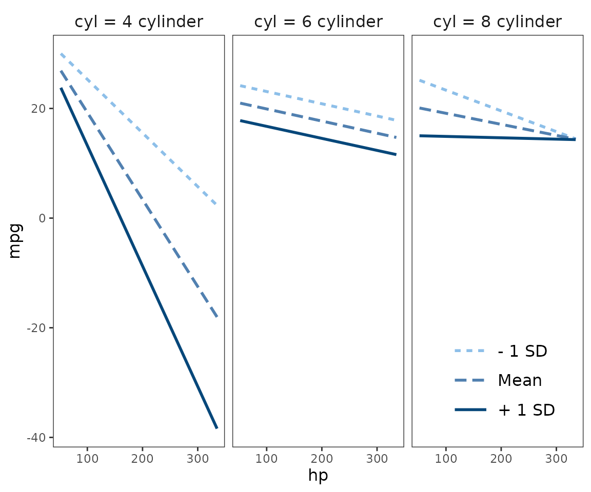

You can get Johnson-Neyman plots for 3-way interactions as well, but
keep in mind what I mentioned earlier in this section about the J-N
technique for 3-way interactions. You will also need the `cowplot`
package, which is used on the backend to mush together the separate J-N
plots.

``` r

regmodel3 <- svyglm(api00 ~ avg.ed * growth * enroll, design = dstrat)
sim_slopes(regmodel3, pred = growth, modx = avg.ed, mod2 = enroll,
          jnplot = TRUE)
```

    ## ███████████████ While enroll (2nd moderator) =  153.0518 (- 1 SD) ██████████████ 
    ## 
    ## JOHNSON-NEYMAN INTERVAL
    ## 
    ## When avg.ed is OUTSIDE the interval [2.75, 3.82], the slope of
    ## growth is p < .05.
    ## 
    ## Note: The range of observed values of avg.ed is [1.38, 4.44]
    ## 
    ## SIMPLE SLOPES ANALYSIS
    ## 
    ## Slope of growth when avg.ed = 2.085002 (- 1 SD): 
    ## 
    ##   Est.   S.E.   t val.      p
    ## ------ ------ -------- ------
    ##   1.25   0.32     3.86   0.00
    ## 
    ## Slope of growth when avg.ed = 2.787381 (Mean): 
    ## 
    ##   Est.   S.E.   t val.      p
    ## ------ ------ -------- ------
    ##   0.39   0.22     1.75   0.08
    ## 
    ## Slope of growth when avg.ed = 3.489761 (+ 1 SD): 
    ## 
    ##    Est.   S.E.   t val.      p
    ## ------- ------ -------- ------
    ##   -0.48   0.35    -1.37   0.17
    ## 
    ## ████████████████ While enroll (2nd moderator) =  595.2821 (Mean) ███████████████ 
    ## 
    ## JOHNSON-NEYMAN INTERVAL
    ## 
    ## When avg.ed is OUTSIDE the interval [2.84, 7.83], the slope of
    ## growth is p < .05.
    ## 
    ## Note: The range of observed values of avg.ed is [1.38, 4.44]
    ## 
    ## SIMPLE SLOPES ANALYSIS
    ## 
    ## Slope of growth when avg.ed = 2.085002 (- 1 SD): 
    ## 
    ##   Est.   S.E.   t val.      p
    ## ------ ------ -------- ------
    ##   0.72   0.22     3.29   0.00
    ## 
    ## Slope of growth when avg.ed = 2.787381 (Mean): 
    ## 
    ##   Est.   S.E.   t val.      p
    ## ------ ------ -------- ------
    ##   0.34   0.16     2.16   0.03
    ## 
    ## Slope of growth when avg.ed = 3.489761 (+ 1 SD): 
    ## 
    ##    Est.   S.E.   t val.      p
    ## ------- ------ -------- ------
    ##   -0.04   0.24    -0.16   0.87
    ## 
    ## ███████████████ While enroll (2nd moderator) = 1037.5125 (+ 1 SD) ██████████████ 
    ## 
    ## JOHNSON-NEYMAN INTERVAL
    ## 
    ## The Johnson-Neyman interval could not be found. Is the p value for your
    ## interaction term below the specified alpha?
    ## 
    ## SIMPLE SLOPES ANALYSIS
    ## 
    ## Slope of growth when avg.ed = 2.085002 (- 1 SD): 
    ## 
    ##   Est.   S.E.   t val.      p
    ## ------ ------ -------- ------
    ##   0.18   0.31     0.58   0.56
    ## 
    ## Slope of growth when avg.ed = 2.787381 (Mean): 
    ## 
    ##   Est.   S.E.   t val.      p
    ## ------ ------ -------- ------
    ##   0.29   0.20     1.49   0.14
    ## 
    ## Slope of growth when avg.ed = 3.489761 (+ 1 SD): 
    ## 
    ##   Est.   S.E.   t val.      p
    ## ------ ------ -------- ------
    ##   0.40   0.27     1.49   0.14

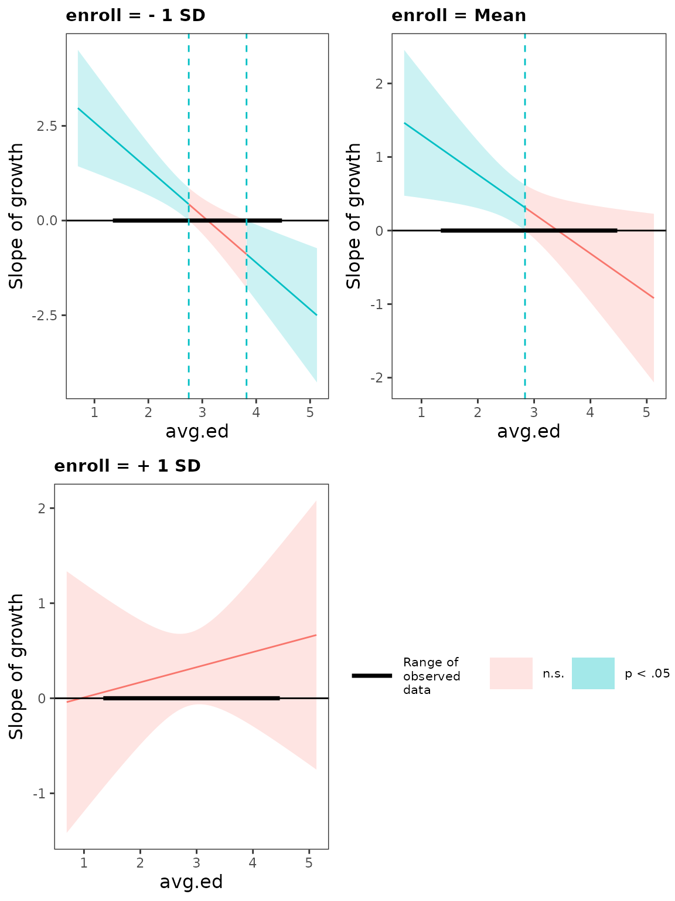

Notice that at one of the three values of the second moderator, there
were no Johnson-Neyman interval values so it wasn’t plotted. The more
levels of the second moderator you want to plot, the more likely that
the resulting plot will be unwieldy and hard to read. You can resize
your window to help, though.

You can also use the `plot` and `as_huxtable` methods with 3-way
`sim_slopes` objects.

``` r

ss3 <- sim_slopes(regmodel3, pred = growth, modx = avg.ed, mod2 = enroll)
plot(ss3)
```

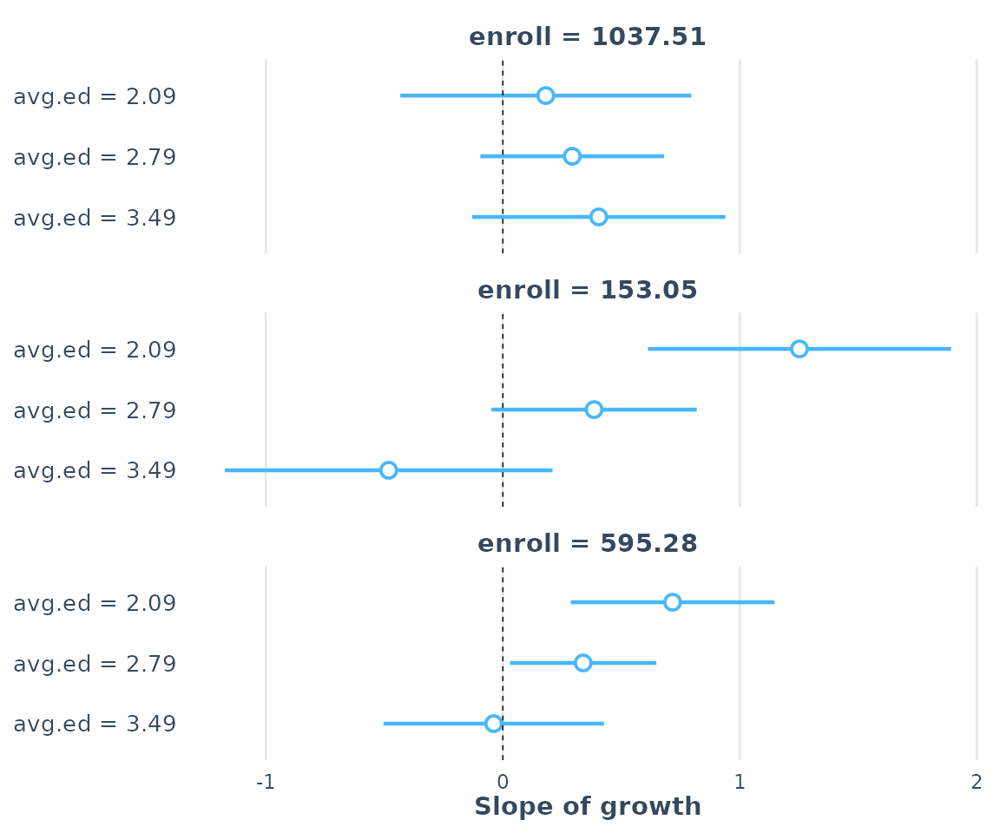

``` r

as_huxtable(ss3)
```

|                  |                   |
|------------------|-------------------|
| enroll = 153     |                   |
| Value of avg.ed  | Slope of growth   |
| 2.09             | 1.25 (0.32)\*\*\* |
| 2.79             | 0.39 (0.22)#      |
| 3.49             | -0.48 (0.35)      |
| enroll = 595.28  |                   |
| Value of avg.ed  | Slope of growth   |
| 2.09             | 0.72 (0.22)\*\*   |
| 2.79             | 0.34 (0.16)\*     |
| 3.49             | -0.04 (0.24)      |
| enroll = 1037.51 |                   |
| Value of avg.ed  | Slope of growth   |
| 2.09             | 0.18 (0.31)       |
| 2.79             | 0.29 (0.20)       |
| 3.49             | 0.40 (0.27)       |

## Generalized linear models, mixed models, et al.

`interact_plot` is designed to be as general as possible and has been
tested with `glm`, `svyglm`, `merMod`, and `rq` models. When dealing
with generalized linear models, it can be immensely useful to get a look
at the predicted values on their response scale (e.g., the probability
scale for logit models).

To give an example of how such a plot might look, I’ll generate some
example data.

``` r

set.seed(5)
x <- rnorm(100)
m <- rnorm(100)
prob <- binomial(link = "logit")$linkinv(.25 + .3*x + .3*m + -.5*(x*m) + rnorm(100))
y <- rep(0, 100)
y[prob >= .5] <- 1
logit_fit <- glm(y ~ x * m, family = binomial)
```

Here’s some summary output, for reference:

``` r

summ(logit_fit)
```

    ## MODEL INFO:
    ## Observations: 100
    ## Dependent Variable: y
    ## Type: Generalized linear model
    ##   Family: binomial 
    ##   Link function: logit 
    ## 
    ## MODEL FIT:
    ## χ²(3) = 33.99, p = 0.00
    ## Pseudo-R² (Cragg-Uhler) = 0.39
    ## Pseudo-R² (McFadden) = 0.25
    ## AIC = 109.38, BIC = 119.81 
    ## 
    ## Standard errors:MLE
    ## ------------------------------------------------
    ##                      Est.   S.E.   z val.      p
    ## ----------------- ------- ------ -------- ------
    ## (Intercept)          0.58   0.25     2.27   0.02
    ## x                    0.54   0.32     1.67   0.10
    ## m                    0.86   0.33     2.62   0.01
    ## x:m                 -1.73   0.46    -3.79   0.00
    ## ------------------------------------------------

Now let’s plot our logit model’s interaction:

``` r

interact_plot(logit_fit, pred = x, modx = m)
```

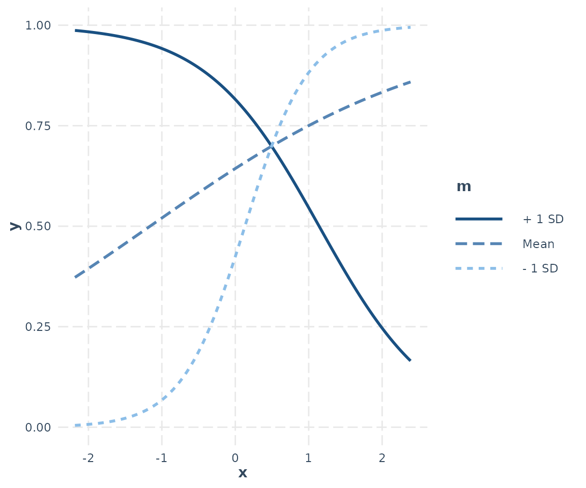

A beautiful transverse interaction with the familiar logistic curve.

### References

Bauer, D. J., & Curran, P. J. (2005). Probing interactions in fixed and
multilevel regression: Inferential and graphical techniques.
*Multivariate Behavioral Research*, *40*, 373–400.

Esarey, J., & Sumner, J. L. (2017). Marginal effects in interaction
models: Determining and controlling the false positive rate.
*Comparative Political Studies*, 1–33.
<https://doi.org/10.1177/0010414017730080>

Fox, J., & Weisberg, S. (2018). Visualizing fit and lack of fit in
complex regression models with predictor effect plots and partial
residuals. *Journal of Statistical Software*, *87*, 1–27.
<https://doi.org/10.18637/jss.v087.i09>

Hainmueller, J., Mummolo, J., & Xu, Y. (2017). How much should we trust
estimates from multiplicative interaction models? Simple tools to
improve empirical practice. *SSRN Electronic Journal*.
<https://doi.org/10.2139/ssrn.2739221>

Johnson, P. O., & Fay, L. C. (1950). The Johnson-Neyman technique, its
theory and application. *Psychometrika*, *15*, 349–367.
